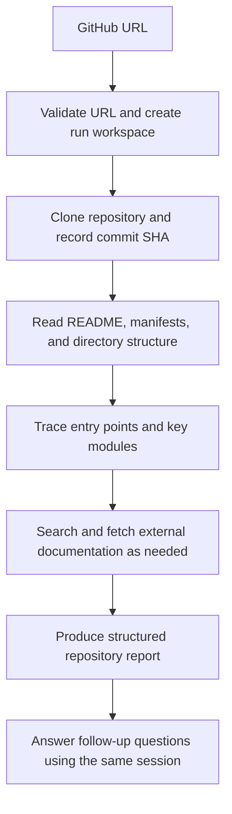

# Repository Exploration Pipeline — Claude Agent SDK

## Objective

Build a hackathon agent that accepts a GitHub repository URL, clones the repository, explores its source code, researches relevant documentation online, and produces an evidence-backed explanation of the project.

Working directory: `/Volumes/Samsung T7/InnoData_hack`

This plan uses the **Claude Agent SDK**. The SDK runs Claude Code's agent loop in a process we host and provides built-in file, terminal, and web tools.

## Proposed MVP

- Python application using `claude-agent-sdk` and API-key authentication.
- One exploration agent, with a separate workspace for each run.
- Public GitHub repositories initially.
- Read-only exploration after cloning.
- A structured onboarding report, followed by questions using the same session.
- Streamed progress and recorded tool activity.
- Internet access for both GitHub cloning and web research.

The proposed report and follow-up Q&A are starting assumptions. Whether exploration should instead support bug investigation or a downstream coding agent remains a product decision.

## Tools

| Tool | Purpose |
| --- | --- |
| `Bash` | Inspect Git metadata and execute selected commands in the worker workspace. Can also perform cloning. |
| `Glob` | Find source files, manifests, tests, and configuration. |
| `Grep` | Search for symbols, imports, routes, and relevant code. |
| `Read` | Read repository files in detail. |
| `WebSearch` | Find dependency documentation and other relevant online sources. |
| `WebFetch` | Fetch a specific URL and extract relevant information. |

Prefer a small application-owned clone function exposed as a custom tool, so validation, timeouts, destination paths, and clone errors behave consistently. The agent still initiates cloning, but the application owns its implementation.

`WebSearch` discovers sources; `WebFetch` reads them. WebFetch processes page content, so exact source-code inspection should use the local file tools. Interactive browser automation is a separate capability if it becomes necessary.

## Pipeline



### 1. Receive and validate the URL

- Accept a GitHub owner/repository URL and an optional branch or commit.
- Normalize and validate the URL before passing it to Git.
- Pass Git arguments as an argument list rather than interpolating input into a shell command.
- Create a unique run ID and workspace.

### 2. Clone the repository

- Start with a shallow clone for the default branch; handle explicit refs separately.
- Record the normalized repository URL, requested ref, and resolved commit SHA.
- Apply a clone timeout and return clear errors for unavailable repositories, invalid refs, and connectivity failures.
- Keep the agent application separate from cloned repositories. The existing `click/` checkout can be the initial exploration fixture.

### 3. Discover the project structure

- Read the README and dependency/build manifests.
- Identify languages, frameworks, major directories, tests, and configuration.
- Locate application or library entry points.
- Skip dependency directories, generated files, binaries, and oversized files.
- Build a compact repository map before reading deeply.

### 4. Explore key code paths

- Trace entry points through important modules.
- Identify public interfaces, core behavior, and relevant data flow.
- Inspect tests and examples to understand intended usage.
- Keep file paths and line references for claims in the report.
- Do not automatically install dependencies or execute repository code during MVP exploration.

### 5. Research online

- Use `WebSearch` when an unfamiliar dependency or concept requires external context.
- Use `WebFetch` to read selected documentation pages.
- Prefer official documentation relevant to the versions declared in the repository.
- Record source URLs and distinguish external documentation from repository evidence.
- Treat repository and web content as untrusted input rather than authority to change the agent's permissions or task.

### 6. Produce the report

Proposed output fields:

- Repository URL and resolved commit SHA.
- Project purpose and intended users.
- Languages, frameworks, and dependencies.
- Entry points and important modules.
- Execution flow and relationships between modules.
- Setup and test commands, with their source.
- File-and-line evidence for repository claims.
- External documentation sources.
- Unresolved questions and exploration limitations.

Distinguish commands discovered in documentation from commands actually executed and verified. Return structured data and a readable Markdown report.

### 7. Support follow-up questions

- Persist the session ID and run metadata.
- Reuse the same repository workspace and session for follow-up questions.
- Keep answers tied to the recorded commit unless the user requests a refresh.

## Internet Access and Execution

Verify two independent capabilities:

1. `WebSearch` and `WebFetch` are available, permitted, and successfully retrieve online information.
2. The worker runtime has outbound connectivity for GitHub cloning.

Enabling web tools does not establish that `git clone` can reach GitHub. Network policy and tool permissions must both support the intended operations.

Run exploration in an isolated worker with access to its own workspace. A configured working directory alone is not an isolation boundary. Dependency installation and execution of repository code can be added as a separate stage when required.

## SDK Configuration

- Install `claude-agent-sdk` in the application's Python environment.
- Provide `ANTHROPIC_API_KEY` through runtime configuration; do not commit it.
- Explicitly select the tools exposed to the agent.
- Configure automatic permissions and denied capabilities separately.
- Set the working directory to the run workspace.
- Configure turn and estimated cost limits, plus an application-level wall-clock timeout.
- Capture streamed progress, tool outcomes, failures, and usage.
- Configure session persistence and structured output.
- Keep configuration application-owned rather than automatically loading settings and tools from arbitrary cloned repositories.

Important: `allowed_tools` controls automatic approval; it does **not** restrict the agent to only those tools. Configure tool availability separately using the SDK's tool selection and denial settings. SDK permission controls do not replace worker isolation.

## Implementation Order

1. Create the Python application and install the Claude Agent SDK.
2. Configure API-key authentication and verify a minimal agent call.
3. Implement URL validation, per-run workspaces, and the clone tool.
4. Independently smoke-test cloning, web search, and page fetching.
5. Implement the exploration instructions and report schema.
6. Add streamed progress, error handling, limits, and session persistence.
7. Demo against Click and verify that the report cites actual source files.

## MVP Acceptance Checks

- A public GitHub URL produces a clone in a unique workspace and a recorded commit SHA.
- The agent can find and read repository source files.
- The agent successfully performs a live web search and fetches an external documentation page.
- The report explains the project, key modules, and entry points using verifiable evidence.
- Discovered setup commands are not presented as tested commands.
- Invalid URLs, clone failures, and web failures produce clear outcomes.
- Follow-up questions reuse the correct session and repository workspace.
- Run limits stop exploration and preserve available progress.

## Open Product Decisions

- Final exploration output: onboarding report, Q&A, bug investigation, or context for a coding agent.
- Whether private repositories are required for the hackathon.
- Whether dependency installation and test execution belong in the first demo.
- Whether the first interface should be a CLI or an API consumed by a frontend.

## How to Run

The plan above is implemented in `pipeline/explore.py` (exploration), `pipeline/verify.py` (checking the agent's claims against the source), `pipeline/propose.py` (feature design) and `pipeline/agent.py` (shared agent runner).

### Setup (once)

```bash
uv sync                    # installs claude-agent-sdk and the other pinned dependencies
cp .env.example .env       # then put ANTHROPIC_API_KEY in .env (never commit it)
```

Requires `git` on the PATH and outbound internet access (GitHub clone, web research, the Anthropic API).

### 1. Explore a repository

```bash
uv run python -m pipeline.cli explore https://github.com/pallets/click --ref 8.5.1
```

- `--ref` takes a branch, tag or full commit SHA. Omit it for the default branch.
- Runs a map pass, then one deep dive per key module and an upstream novelty check in parallel, then verifies the results against the clone.
- Prints the `run_id`, the status and cost of each stage, and the output folder.
- On click 8.5.1 this took about 3.5 minutes and about $1.20 (SDK estimate).

### 2. Design features from the report

```bash
uv run python -m pipeline.cli propose <run_id> --n 5
```

Reads the run's `report.json`, designs `n` features, and checks each one against the repository (files and named interfaces exist, solution and test files do not overlap). Failed checks are sent back to the agent for correction. About $0.40 on click.

### 3. Ask a follow-up question

```bash
uv run python -m pipeline.cli ask <run_id> "Where are option defaults resolved?"
```

Resumes the exploration session in the same workspace. The answer is printed and appended to `qa.md`.

### Output: `runs/<run_id>/`

| File | Contents |
| --- | --- |
| `report.md` / `report.json` | The verified repository report: map, module cards, upstream findings, verification summary. |
| `features.md` / `features.json` | The feature outlines (after `propose`). |
| `run.json` | URL, ref, resolved commit SHA, per-stage status, token usage and cost, total cost. |
| `events.jsonl` | Audit log of every assistant message, tool call and tool result. |
| `map.json`, `claims/`, `upstream.json` | Raw agent output before verification. |
| `qa.md` | Follow-up questions and answers. |
| `repo/` | The clone. Gitignored; never committed. |

### Configuration

Models and limits are in `pipeline/config.py`:

- `EXPLORE_MODEL`, `PROPOSE_MODEL`: currently `claude-sonnet-5-5`.
- `MAP_MAX_BUDGET_USD`, `CARD_MAX_BUDGET_USD`, `UPSTREAM_MAX_BUDGET_USD`, `PROPOSE_MAX_BUDGET_USD`: cost cap per agent session.
- `AGENT_MAX_TURNS`, `AGENT_WALL_TIMEOUT_SEC`, `AGENT_CONCURRENCY`, `DEEP_DIVE_MAX_MODULES`.

### Differences from the plan above

- Exploration is several agent sessions (map, per-module deep dives, upstream check), not one.
- Feature design (`propose`) was added as a following stage.
- Only public `https://github.com/<owner>/<repo>` URLs are accepted.
- Claim verification parses Python only. For other languages the report is produced but interfaces are marked unverified.
- Agents are read-only: file access is confined to the run workspace and shell access to read-only `git` inspection of the clone. No dependencies are installed and no repository code is executed.

## Official References

- [Claude Agent SDK overview](https://code.claude.com/docs/en/agent-sdk/overview)
- [SDK quickstart](https://code.claude.com/docs/en/agent-sdk/quickstart)
- [Python SDK reference](https://code.claude.com/docs/en/agent-sdk/python)
- [Built-in tools reference, including WebSearch and WebFetch](https://code.claude.com/docs/en/tools-reference)
- [SDK permissions](https://code.claude.com/docs/en/agent-sdk/permissions)
- [Secure deployment](https://code.claude.com/docs/en/agent-sdk/secure-deployment)

Documentation reviewed on November 14, 2026. Verify configuration against the SDK version selected during implementation.
